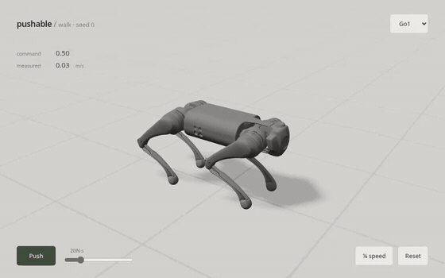

# weeble

[Walk the dog, shove it over, and watch it get back up.](https://mottopanikeiku.github.io/weeble/) Steer a Go1 quadruped or G1 humanoid with WASD or the touch pad, drag a body, or throw a ball at it. The simulation runs locally in your browser using MuJoCo compiled to WebAssembly; the dog has a separate get-up policy.

[](https://mottopanikeiku.github.io/weeble/)

## Training

I trained the policies with PPO using [MuJoCo Playground](https://github.com/google-deepmind/mujoco_playground) tasks and [Brax](https://github.com/google/brax) on a single cloud GPU. The browser runs the exported weights with the same robot models and observation layout. Switch between dogs trained on flat ground, with random shoves, or on rough ground; press **I** to see the policy inputs and outputs.

<!-- generated:cost:start -->
On one NVIDIA L4, a flat-ground dog took 12–14 minutes ($0.22–0.25) and a walking humanoid took 45–49 minutes ($0.79–0.86) per policy. The rough-ground dog took 18–19 minutes ($0.31–0.34). Dog get-up took 15–16 minutes ($0.27–0.28). Training the 15 released policies cost $5.65; all cloud jobs, including failures, totaled $12.98. Costs are upper estimates from runtime and list prices. [Training runs](results/report/training.csv) · [All jobs](results/report/invocations.csv)
<!-- generated:cost:end -->

The [browser controller](web/src/physics.ts) matches a [NumPy reference](eval/sim.py), with recorded action differences below [5 × 10⁻⁷](results/parity-checks/wasm.json). Dog recovery switches to a get-up policy after a fall, then back to walking once the stance is steady.

## Robustness atlas

<!-- generated:atlas:start -->
I tested the 12 released walking policies over 21,600 MuJoCo episodes: three training seeds each for the flat-ground dog, shove-trained dog, rough-ground dog and humanoid. Each setting has 50 episodes per seed, with no retraining.

The first six rows show the hardest tested setting with no falls in at least 90% of episodes at that level and every easier level. Ranges cover the three seeds. The last row gives the no-fall rate for each seed's worst full-range command change.

| Stress | Go1, flat | Go1, shoves | Go1, rough | G1 |
|---|---|---|---|---|
| Held-out rubble height | 5 cm | 5 cm | 5 cm–7.5 cm | flat |
| Floor friction | μ 0.15 | μ 0.15 | μ 0.15 | μ 0.15–μ 0.25 |
| Payload (of body mass) | +40% | +40% | +40% | +10%–+30% |
| Actuator strength | 70% | 70% | 70%–85% | 85%–100% |
| Sensor delay | 20 ms | 20 ms | 20 ms | 20 ms–40 ms |
| Shove, J/(m√(gh)) | 0.5 | 1–1.25 | 0.5 | 0 |
| Command changes: worst no-fall rate | 96%–100% | 98%–100% | 94%–100% | 100% |

A normalized shove of 1 is 20.2 N·s for Go1 and 85.3 N·s for G1, using body mass m and centre-of-mass height h. A threshold at the edge of the test range is a lower bound on tolerance.

- Rough-ground training improved the rubble threshold in 2 of 3 seeds: 5 cm for the flat-trained dogs versus 5 cm–7.5 cm for the rough-trained dogs.
- Across all nine dog policies, the added-mass threshold was +40%, but the sensor-delay threshold was only 20 ms.

[All stress levels](results/atlas/report/atlas.svg) · [Per-seed results and intervals](results/atlas/report/atlas_seeds.csv) · [Thresholds](results/atlas/report/margins.csv) · [Method](docs/evaluation.md#robustness-atlas)
<!-- generated:atlas:end -->

<!-- generated:headline:start -->
Training with random shoves raised Go1's 50%-survival impulse from 24.1 to 32.9 N·s: a +8.8 N·s difference across three training seeds per variant (95% bootstrap interval +4.6 to +13.1 N·s). [Shove comparison](results/report/ablation.csv)
<!-- generated:headline:end -->

<details>
<summary>Walking, get-up and terrain measurements</summary>

The separate shove comparison uses deterministic policies in standard MuJoCo. A trial succeeds if the robot never tilts beyond 60° or makes non-foot floor contact through 3 seconds after the shove. [Evaluation method](docs/evaluation.md).

<!-- generated:results:start -->
| Policy | Seeds | 50%-survival impulse by seed (N·s) | Forward / lateral / yaw error (m/s, m/s, rad/s) |
|---|---:|---|---|
| Go1, trained without shoves | 3 | 26.8 / 23.4 / 22.7 | 0.068 / 0.058 / 0.057 |
| Go1, trained with shoves | 3 | 31.3 / 31.4 / 35.8 | 0.072 / 0.058 / 0.061 |
| G1 humanoid | 3 | 66.1 / 70.5 / 70.0 | 0.086 / 0.148 / 0.417 |

[Per-seed tracking](results/report/tracking.csv) · [J50 by seed](results/report/j50_seeds.csv) · [survival curves](results/report/push_seeds.svg) · [raw trials](results/eval/)

Two get-up seeds recovered from every fallen start (181/181 and 179/179); the third recovered in 3/187. The median recovery took 2.1 s. [Get-up results](results/report/getup.csv)

For one Go1 seed, the 50%-survival impulse was 30.0 N·s in MJX and 28.3 N·s in standard MuJoCo across 220 paired trials. [Simulator comparison](results/report/gap.csv)

<!-- generated:terrain:start -->

Terrain cross-test: 3 training seeds per variant, 27 commands per seed and terrain. Falls / trials (forward, lateral, yaw error):

| Training terrain | Flat test | Rough test |
|---|---|---|
| Flat | 0/81 (0.045 / 0.035 / 0.038) | 1/81 (0.063 / 0.075 / 0.062) |
| Rough | 0/81 (0.037 / 0.026 / 0.037) | 1/81 (0.041 / 0.033 / 0.047) |

Errors include time after falls: forward/lateral in m/s, yaw in rad/s. [Terrain results](results/report/terrain.csv) · [Per seed](results/report/terrain_seeds.csv)
<!-- generated:terrain:end -->
<!-- generated:results:end -->

</details>

## Run locally

Start the browser demo from a checkout:

```bash
cd web
npm ci
npm run dev
```

Open <http://localhost:5173/weeble/>. [Browser controls and implementation](web/README.md).

From the repository root, check the evaluation and rebuild the tables from the saved trials:

```bash
uv sync --frozen --only-group eval
uv run --no-sync python -m pytest eval -q --ignore=eval/test_parity.py --ignore=eval/test_g1_getup.py
uv run --no-sync python -m eval.verify
```

This install needs MuJoCo, NumPy and pytest, with no GPU or JAX. The [evaluation guide](docs/evaluation.md) has commands for new trials, the full atlas and training on Modal. [CI](.github/workflows/ci.yml) also checks the released checkpoints against Playground on CPU. [GitHub Pages](.github/workflows/pages.yml) builds the demo with `npm run build` and runs `npm test` before deployment.

## Limitations

- Simulation only; I have not run these policies on real robots.
- Three training seeds per variant. The atlas changes one stress at a time and tests one family of rubble.
- Browser props and fall collisions add physics outside the evaluation scene.
- The humanoid turns poorly and has no get-up policy. Its demo uses a checkpoint saved before the training timeout.
- Individual fall outcomes can change with the CPU and software environment; see the [replay comparison](results/atlas/clean-replay.json).

Robot models come from [MuJoCo Menagerie](https://github.com/google-deepmind/mujoco_menagerie), tasks and rewards from [MuJoCo Playground](https://arxiv.org/abs/2502.08844), and the CC0 terrain texture from [Poly Haven](https://polyhaven.com/a/rock_face). [Asset licenses](assets/).
