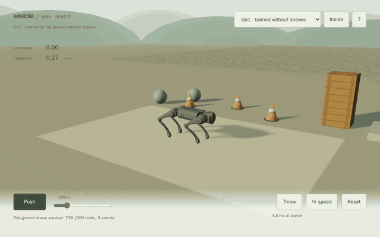
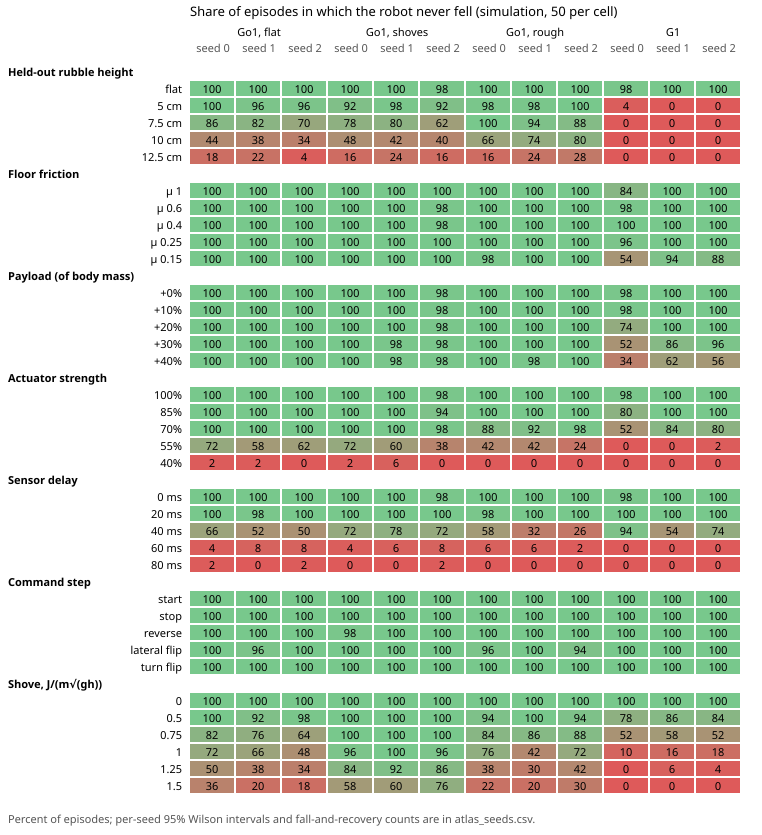

# weeble

[](https://mottopanikeiku.github.io/weeble/)

Walking policies for a Unitree Go1 dog and a G1 humanoid, trained with PPO and running in the browser on MuJoCo's WebAssembly build. In the [demo](https://mottopanikeiku.github.io/weeble/) you steer with WASD or a touch pad, drag the robots around, shove them or throw a ball at them. When the dog falls, a second policy gets it back up. The humanoid waits for you to press Reset.

## Training

PPO on [MuJoCo Playground](https://github.com/google-deepmind/mujoco_playground) tasks with [Brax](https://github.com/google/brax), run on Modal. The browser loads the exported weights with the same robot models and observation layout; replaying recorded C MuJoCo rollouts in the browser reproduces the actions to within 5×10⁻⁷.

| Policy | Time on one L4 | Cost |
|---|---|---|
| Go1 walking, flat ground or with shoves | 12–14 min | $0.22–0.25 |
| Go1 walking, rough ground | 18–19 min | $0.31–0.34 |
| Go1 get-up | 15–16 min | $0.27–0.28 |
| G1 walking | 45–49 min | $0.79–0.86 |

Costs are Modal list-price estimates. The 15 policies behind the demo came to $5.65, and every cloud job including the failed ones to $12.98.

## Shoves

Each walking policy got at least 100 shoves per impulse, three training seeds per policy. The table gives the impulse at which half the shoves end in a fall.

| Policy | 50% fall impulse |
|---|---:|
| Go1, trained without shoves | 24 N·s |
| Go1, trained with random shoves | 33 N·s |
| G1 humanoid | 69 N·s |

Shove training added 8.8 N·s for the dog (95% bootstrap interval 4.6 to 13.1). The humanoid is a much heavier robot, so its number doesn't compare with the dog's.

Training on rough ground helped less than I expected. Flat-trained and rough-trained dogs each fell once in 81 runs on rough ground, though the rough-trained ones follow speed commands more closely there.

## Stress tests

I ran all 12 released walking policies through 36 stress levels they never trained on, 50 episodes each. Each cell is the share of episodes where the robot never fell.



The dogs handled extra weight and slippery floors much better than delayed sensor readings. The humanoid fell on almost every rubble field, even the lowest. Per-stress numbers and the protocol are in [docs/evaluation.md](docs/evaluation.md#robustness-atlas).

## Getting back up

The dog's get-up policy recovered from every fallen start in two of its three training seeds (181/181 and 179/179), usually in about 2 seconds. The third seed managed 3 of 187. The demo uses seed 0.

Two attempts at a humanoid get-up policy, at 50M and 300M steps, recovered 0 of 200 drops each. The humanoid also turns badly, and its demo policy is a checkpoint saved at 181M of 200M steps, when the training run hit its time limit.

## Running locally

```bash
cd web
npm ci
npm run dev        # http://127.0.0.1:5173/weeble/
```

To run the evaluation tests and rebuild every result table from the saved trials (CPU only, no JAX):

```bash
uv sync --frozen --only-group eval
uv run --no-sync python -m pytest eval -q --ignore=eval/test_parity.py --ignore=eval/test_g1_getup.py
uv run --no-sync python -m eval.verify
```

The repo holds the demo (`web/`, [notes](web/README.md)), the Modal training jobs (`train/`), the MuJoCo evaluation and stress-test code (`eval/`), the exported policies as JSON (`policies/`, [format](policies/README.md)), raw trials and tables (`results/`) and the robot models (`assets/`). The original Brax checkpoints are on the [`policies-2026-10-14` release](https://github.com/mottopanikeiku/weeble/releases/tag/policies-2026-10-14); `python -m train.fetch_checkpoints` downloads and verifies them.

Robot models are from [MuJoCo Menagerie](https://github.com/google-deepmind/mujoco_menagerie), tasks and rewards from [MuJoCo Playground](https://arxiv.org/abs/2502.08844), and the CC0 rock texture from [Poly Haven](https://polyhaven.com/a/rock_face). MIT licensed, with asset licenses in `assets/`.
